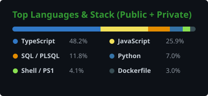

  
  

    
    
    
  

---

### Sobre

Engenheiro Backend em formação (**ADS**) com base prática em **Infraestrutura, Redes (MikroTik/UniFi) e Linux**. Construo APIs tipadas de ponta a ponta com foco em **consistência transacional, isolamento multi-tenant, observabilidade e segurança desde o commit (Shift-Left AppSec)**.

- **Arquitetura & Qualidade:** Clean Architecture, TDD, locks pessimistas, filas resilientes e **PostgreSQL RLS**.
- **Engenharia AI-First:** Orquestração Multi-Agente + **MCP (Model Context Protocol)** com guardrails determinísticos e SAST automatizado (**Semgrep**).

---

### Projetos em Destaque

<table>
  <tr>
    <td width="50%" valign="top">
      <a href="https://github.com/PedroNHD/picpay-backend-challenge"><strong>💸 PicPay Backend Challenge</strong></a> 
      API de transferências ACID com lock pessimista ordenado (<code>FOR UPDATE</code>), <code>Idempotency-Key</code>, autorizador externo e notificações resilientes via BullMQ.  
      <code>NestJS</code> <code>PostgreSQL</code> <code>Prisma</code> <code>Redis</code> <code>BullMQ</code> <code>Jest</code>
    </td>
    <td width="50%" valign="top">
      <a href="https://github.com/PedroNHD/woovi-leaky-bucket-challenge"><strong>🛡️ Woovi Leaky Bucket Challenge</strong></a> 
      Rate Limiter anti-enumeração estilo DICT/Pix com <strong>Lua Scripts atômicos no Redis</strong>, reembolso em sucesso e isolamento por tenant.  
      <code>Fastify</code> <code>TypeScript</code> <code>Redis Lua</code> <code>Zod</code> <code>Vitest</code>
    </td>
  </tr>
  <tr>
    <td width="50%" valign="top">
      <a href="https://github.com/PedroNHD/AfterShip-Challenge"><strong>💱 AfterShip Exchange Rate</strong></a> 
      API de cotações e conversão de moedas com processamento assíncrono em filas, cache distribuído e persistência relacional.  
      <code>Fastify</code> <code>PostgreSQL</code> <code>Redis</code> <code>BullMQ</code> <code>Docker</code>
    </td>
    <td width="50%" valign="top">
      <a href="https://github.com/PedroNHD/ZeDelivery-Challenge"><strong>📍 Zé Delivery Backend Challenge</strong></a> 
      API de geoprocessamento com consultas espaciais em <code>MultiPolygon</code> e busca de PDV mais próximo em alta performance.  
      <code>Fastify</code> <code>Oracle Spatial</code> <code>TypeORM</code> <code>Docker</code> <code>Jest</code>
    </td>
  </tr>
</table>

---

### Stack

  

---

### Atividade

  
  

---

  
🌐 <b>English Version (Click to expand)</b>

   

  ### About

  **Backend Engineer** (Systems Analysis & Development) with hands-on background in **IT Infrastructure, Enterprise Networking (MikroTik/UniFi), and Linux**. I build end-to-end typed APIs focused on **transactional consistency, multi-tenant isolation, observability, and Shift-Left AppSec**.

  - **Architecture & Quality:** Clean Architecture, TDD, pessimistic locking, resilient queues, and **PostgreSQL RLS**.
  - **AI-First Engineering:** Multi-Agent orchestration + **MCP (Model Context Protocol)** with deterministic guardrails and automated **Semgrep SAST**.

  ### Featured Projects

  - **💸 [PicPay Backend Challenge](https://github.com/PedroNHD/picpay-backend-challenge)** — ACID financial transfers with ordered `FOR UPDATE` locking, `Idempotency-Key`, external authorization, and BullMQ notifications (`NestJS`, `PostgreSQL`, `Prisma`, `Redis`, `Jest`).
  - **🛡️ [Woovi Leaky Bucket Challenge](https://github.com/PedroNHD/woovi-leaky-bucket-challenge)** — Pix/DICT-style anti-enumeration rate limiter with atomic Redis Lua scripts, success refunds, and per-tenant isolation (`Fastify`, `TypeScript`, `Redis Lua`, `Zod`, `Vitest`).
  - **💱 [AfterShip Exchange Rate](https://github.com/PedroNHD/AfterShip-Challenge)** — Exchange rate API with async job queues, distributed caching, and relational persistence (`Fastify`, `PostgreSQL`, `Redis`, `BullMQ`, `Docker`).
  - **📍 [Zé Delivery Backend Challenge](https://github.com/PedroNHD/ZeDelivery-Challenge)** — High-performance spatial query API (`MultiPolygon` coverage and nearest point-of-sale lookup) (`Fastify`, `Oracle Spatial`, `TypeORM`, `Docker`, `Jest`).

